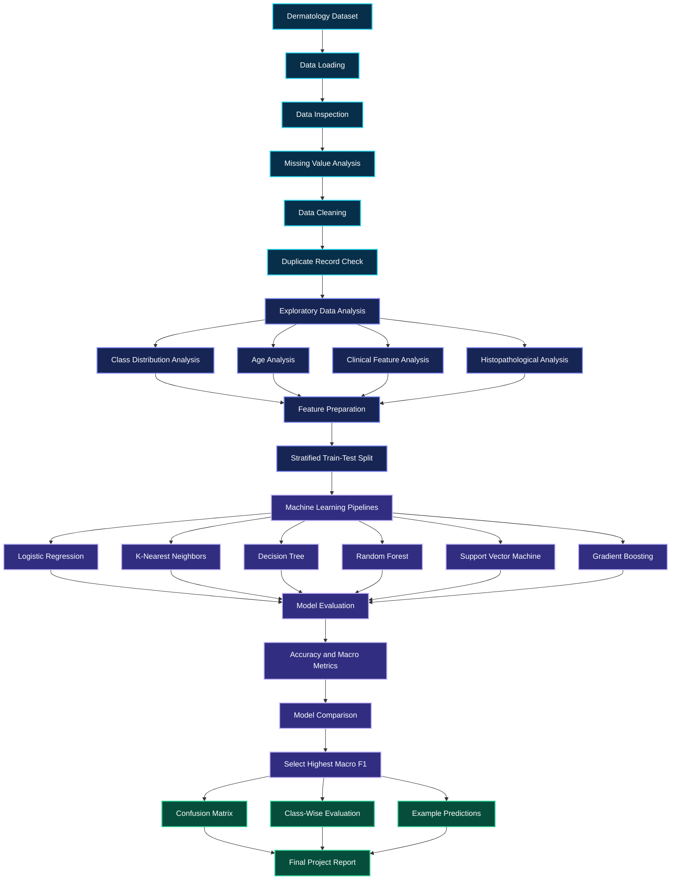
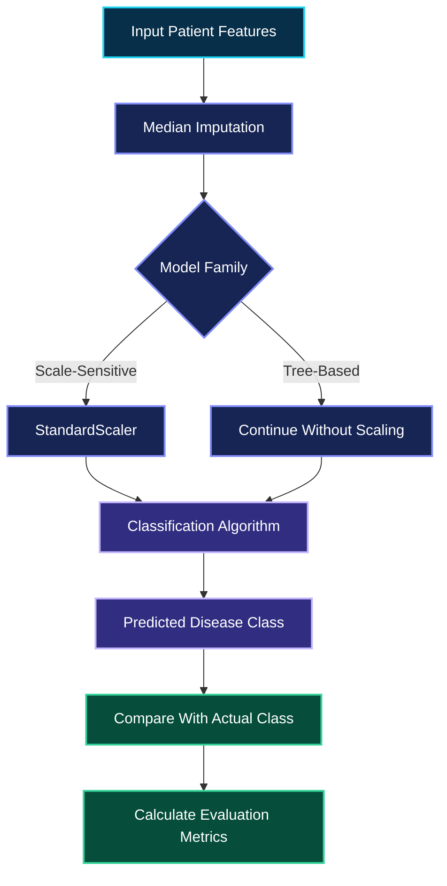
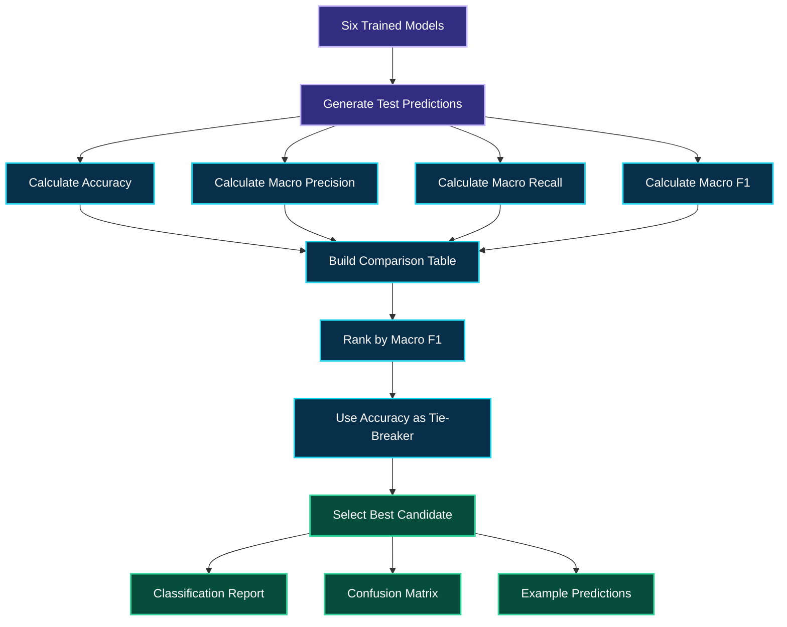

<div align="center">


<br/>


<br/><br/>


<br/><br/>


<br/><br/>

**34 INPUT FEATURES. SIX DISEASE CLASSES. SIX CLASSIFICATION ALGORITHMS. ONE COMPARATIVE MACHINE LEARNING WORKFLOW.**

<br/>

<a href="#01-project-overview">PROJECT OVERVIEW</a>
  |   <a href="#02-system-architecture">ARCHITECTURE</a>
  |   <a href="#08-machine-learning-laboratory">ML LABORATORY</a>
  |   <a href="#12-performance-intelligence-dashboard">PERFORMANCE</a>
  |   <a href="#18-future-development">ROADMAP</a>

</div>

---

# 01. Project Overview

## Engineering Intelligence for Skin Disorder Classification

Skin disorders can exhibit overlapping clinical and histopathological characteristics. Analyzing these characteristics systematically can help researchers investigate patterns in medical data and evaluate machine learning approaches to disease classification.

This project, **PRCP-1027 — Skin Disorder Prediction**, implements a complete data analysis and machine learning classification workflow using a dermatology dataset containing 366 patient records and 34 input attributes, as described in the project notebook.

The system analyzes clinical and histopathological features, prepares the dataset for classification, trains six machine learning algorithms, and compares their predictive performance.

The target contains six skin-disease classes.

The model comparison uses accuracy, macro precision, macro recall, and macro F1-score. A production candidate is selected using the highest macro F1-score on the held-out test set.

The notebook also includes class-wise performance analysis, confusion matrices, feature-importance analysis, example predictions, and suggestions for responsible clinical decision support.

### Project Mission

Build a reproducible machine learning workflow that demonstrates how structured dermatology data can be analyzed and used to compare multiclass classification models.

### Core Objectives

**Medical data intelligence**

Investigate the structure, quality, distribution, and statistical characteristics of dermatology records.

**Clinical feature analysis**

Explore the relationships between clinical attributes, histopathological attributes, age, and the target disease classes.

**Multiclass classification**

Train and compare six machine learning algorithms using a common train-test split.

**Performance evaluation**

Assess overall and class-wise model behavior using multiple classification metrics.

**Model interpretation**

Examine feature importance and confusion matrices to better understand the selected model's predictions.

**Responsible decision support**

Document how predictions might support further assessment while recognizing that the model is not a clinically validated diagnostic system.

---

# 02. System Architecture

## Inside the Skin Disorder Intelligence Pipeline

The project follows a structured workflow that transforms raw patient records into evaluated classification models.



### Architecture Breakdown

**Stage 1 — Data ingestion**

Load the dermatology CSV file into a Pandas DataFrame and inspect its dimensions and columns.

**Stage 2 — Data quality**

Identify missing values, convert invalid age markers into proper missing values, impute missing ages, and check duplicate records.

**Stage 3 — Exploratory analysis**

Investigate the distribution of disease classes, age patterns, clinical features, and histopathological features.

**Stage 4 — Feature preparation**

Separate the target column from the input features and prepare the data for model training.

**Stage 5 — Model training**

Train six classification algorithms using the same stratified training and testing subsets.

**Stage 6 — Model evaluation**

Calculate accuracy, macro precision, macro recall, and macro F1-score.

**Stage 7 — Model interpretation**

Examine class-wise classification results, confusion matrices, feature importance, and example predictions.

**Stage 8 — Final reporting**

Summarize the selected model and document the limitations and responsible use of its predictions.

---

# 03. Dataset Intelligence

## Understanding the Medical Feature Space

The project uses a dermatology dataset containing 366 patient records and 34 input attributes, according to the project notebook's description.

The target variable is named `class`.

Each record is associated with one of six disease classes.

### Dataset Profile

| Property                       | Description                              |
| ------------------------------ | ---------------------------------------- |
| Dataset                        | Dermatology dataset                      |
| Records in project description | 366                                      |
| Input attributes               | 34                                       |
| Target column                  | `class`                                  |
| Number of target classes       | 6                                        |
| Clinical attributes            | 11, according to the project description |
| Histopathological attributes   | 22, according to the project description |
| Age                            | Linear-valued feature                    |
| Family history                 | Binary feature represented using 0 and 1 |
| Development environment        | Jupyter Notebook                         |
| Data processing                | Pandas and NumPy                         |
| Classification framework       | Scikit-learn                             |

The 34 input attributes include the age feature and the other clinical and histopathological attributes described in the notebook.

The actual dataset dimensions after cleaning should be taken from the notebook's execution output because duplicate removal can change the final record count.

### The Six Disease Classes

The notebook maps the six target class IDs to the following disease names.

| Class ID | Disease Name             |
| -------: | ------------------------ |
|        1 | Psoriasis                |
|        2 | Seboreic dermatitis      |
|        3 | Lichen planus            |
|        4 | Pityriasis rosea         |
|        5 | Cronic dermatitis        |
|        6 | Pityriasis rubra pilaris |

These labels follow the terminology in the supplied project notebook.

The class IDs are used as classification targets. The model learns to predict one of the represented categories based on the available input features.

### Clinical Attributes

Clinical attributes describe the patient characteristics and clinical observations represented in the dataset.

The notebook examines the average values of the clinical features across disease classes.

This analysis helps investigate whether the classes display different patterns in the available clinical measurements.

### Histopathological Attributes

Histopathological attributes represent additional diagnostic information recorded in the dataset.

The notebook compares average histopathological feature values across the six target classes.

These comparisons help explore differences in the dataset but do not establish that an individual feature causes a particular disease.

---

# 04. Data Cleaning and Quality Control

## Building a Reliable Input Dataset

The notebook performs several data preparation steps before training the classification models.

### Missing Age Values

The dataset represents some missing age values using the character `?`.

These values cannot be treated as ordinary numerical observations.

The notebook converts `?` to missing values and fills missing ages using the median of the available patient ages.

Median imputation provides a straightforward way to retain records with missing age information.

### Duplicate Records

Duplicate rows are checked during preprocessing.

If duplicates are present, the notebook removes them and resets the DataFrame index.

This reduces the risk of repeated records influencing the model comparison.

### Target Separation

The `class` column is retained as the prediction target.

All other columns are used as input features.

No patient name or ID is used as a predictor in the notebook's feature preparation.

### Feature Imputation

The model pipelines use `SimpleImputer` with median imputation for numerical input features.

This allows the training and prediction pipelines to handle missing numerical values consistently.

### Feature Scaling

Some algorithms are sensitive to the scale of their input features.

For example, age may have a larger numerical range than features represented using values from 0 to 3.

The notebook uses `StandardScaler` inside pipelines for algorithms that benefit from scaled input features.

Scaling is performed within the pipeline so the scaler is fitted using the training data rather than the complete dataset.

### Why a Pipeline Matters

A Scikit-learn Pipeline combines preprocessing steps and a model into one consistent workflow.

This reduces the chance of accidentally applying different preprocessing during training and prediction.

It also makes the model comparison more systematic because each algorithm can be trained and evaluated using its corresponding pipeline.

---

# 05. Exploratory Data Analysis

## Discovering Patterns Across Six Disease Classes

Exploratory Data Analysis provides an overview of the dataset before predictive modeling begins.

The notebook examines class distributions, age patterns, clinical feature averages, and histopathological feature averages.

### Class Distribution Analysis

The distribution of the six target classes is examined before training.

Class imbalance matters because some disease classes may contain more records than others.

If one class dominates the dataset, a model might obtain reasonable overall accuracy while performing poorly on less frequent classes.

This is one reason the project evaluates macro-averaged precision, recall, and F1-score.

### Age Distribution Analysis

The notebook investigates age-related patterns in the dataset.

Age distributions can be compared across the disease classes to explore whether the available records exhibit differences in age.

These observations describe the dataset and should not be interpreted as population-wide epidemiological conclusions.

### Clinical Feature Analysis

The notebook examines average clinical feature values across the six disease classes.

This provides a comparative view of the clinical information represented in the dataset.

### Histopathological Feature Analysis

The histopathological analysis compares feature averages across disease classes.

The results help identify variables that differ across the recorded classes and may be useful for further model interpretation.

### Data Summary

Descriptive statistics help characterize the numerical features.

The analysis can reveal unusual values, differences in feature scales, and patterns that deserve additional inspection.

The actual charts and numerical summaries are generated by executing the notebook.

---

# 06. Feature Engineering and Preparation

## From Medical Attributes to Model Inputs

The notebook separates the input matrix and target vector.

Conceptually, the operation is:

```python
X = df_clean.drop("class", axis=1)
y = df_clean["class"]
```

`X` contains the patient features used by the classifiers.

`y` contains the six-class target labels.

### Feature Preparation Workflow


### Stratified Train-Test Split

The notebook uses an 80:20 stratified train-test split.

Stratification helps preserve approximately the same relative distribution of disease classes in both subsets.

The training set is used to fit the models.

The testing set is held out for the notebook's model evaluation.

Using the same split across the six algorithms helps make the comparison more consistent.

However, selecting a model based on test-set performance means the test set also influences the model-selection decision. A separate validation set or nested cross-validation would provide a stronger estimate of generalization if the project were extended.

---

# 07. Machine Learning Laboratory

## Six Algorithms. One Consistent Evaluation Framework.

The notebook compares six machine learning classification algorithms.

Each algorithm learns the relationship between the patient feature values and the six disease classes.

### Model 01 — Logistic Regression

Logistic Regression is a classification algorithm that estimates class probabilities using a linear decision structure.

For multiclass problems, it can estimate the probability associated with each class and choose the most likely prediction.

It provides a useful baseline against which more flexible algorithms can be compared.

The notebook uses an increased iteration limit to support model convergence.

### Model 02 — K-Nearest Neighbors

K-Nearest Neighbors classifies a record using nearby training observations.

The notebook configures five neighbors.

Feature scaling is important because distance-based algorithms can be affected by differences in feature magnitude.

KNN provides a useful comparison against models that learn explicit decision boundaries.

### Model 03 — Decision Tree

Decision Tree learns a sequence of feature-based rules.

Each split separates observations according to selected feature conditions.

Decision trees can represent nonlinear relationships and provide an interpretable model structure.

However, an individual tree can be sensitive to changes in training data and may overfit.

### Model 04 — Random Forest

Random Forest combines multiple decision trees to produce a classification result.

The notebook configures 300 trees.

The ensemble approach can represent complex feature relationships while reducing reliance on the behavior of a single tree.

Random Forest is also used in the notebook's exploratory feature-importance analysis.

### Model 05 — Support Vector Machine

Support Vector Machine learns decision boundaries that separate classes.

The notebook includes an SVM classifier in the comparative modeling workflow.

Scaling is included in its pipeline because the magnitude of input features can affect the algorithm's behavior.

SVM provides another approach to multiclass classification alongside linear, tree-based, and distance-based models.

### Model 06 — Gradient Boosting

Gradient Boosting builds an ensemble of decision trees sequentially.

Each new stage attempts to improve the existing ensemble by focusing on errors made by earlier stages.

This method can learn nonlinear relationships between input attributes and disease classes.

Its effectiveness depends on the dataset and the selected configuration.

### Algorithm Comparison

| Algorithm              | Learning Approach             | Main Purpose                            |
| ---------------------- | ----------------------------- | --------------------------------------- |
| Logistic Regression    | Linear classification         | Establish a baseline                    |
| K-Nearest Neighbors    | Distance-based classification | Learn from similar observations         |
| Decision Tree          | Rule-based classification     | Capture nonlinear feature relationships |
| Random Forest          | Tree ensemble                 | Combine multiple decision trees         |
| Support Vector Machine | Margin-based classification   | Learn separating decision boundaries    |
| Gradient Boosting      | Sequential tree ensemble      | Improve predictions through boosting    |

The project compares these models using the same training and testing subsets.

No algorithm should be assumed to be the best before the evaluation results are examined.

---

# 08. Machine Learning Pipeline

## Consistent Preprocessing and Training

The notebook constructs model pipelines for the six algorithms.

For scale-sensitive algorithms, the pipeline includes median imputation followed by standard scaling and classification.

Tree-based algorithms use median imputation without standard scaling in the configured workflow.

This keeps preprocessing connected to model training and helps ensure that each model receives consistently prepared data.



The diagram represents the preprocessing logic used by the notebook. The exact operations for each model are defined in the corresponding Scikit-learn Pipeline.

---

# 09. Model Evaluation Framework

## Measuring More Than Accuracy

The project calculates four principal evaluation metrics.

These metrics describe different aspects of multiclass classification performance.

### Accuracy

Accuracy measures the proportion of test observations correctly classified by the model.

It provides a general overview of prediction correctness.

However, accuracy alone may hide weak performance on smaller disease classes.

### Macro Precision

Macro precision calculates precision separately for each class and then averages the class-level values equally.

This gives each disease class equal weight in the final metric.

### Macro Recall

Macro recall calculates recall separately for each class and averages the results equally.

It helps reveal whether a model identifies the different classes effectively rather than performing well only on more frequent classes.

### Macro F1-Score

Macro F1-score calculates the F1-score for each class and averages those scores equally.

The project uses macro F1-score as its primary model-selection metric.

This is useful for a six-class problem because performance across all classes matters.

### Evaluation Summary

| Metric          | What It Measures                                   | Desired Direction |
| --------------- | -------------------------------------------------- | ----------------- |
| Accuracy        | Overall classification correctness                 | Higher            |
| Macro Precision | Average class-wise precision                       | Higher            |
| Macro Recall    | Average class-wise recall                          | Higher            |
| Macro F1-score  | Average class-wise balance of precision and recall | Higher            |

The notebook calculates these metrics on the held-out test set.

Their actual values depend on executing the notebook with the supplied dataset.

---

# 10. Model Selection Engine

## Selecting the Production Candidate

The project selects a production candidate using the highest macro F1-score on the held-out test set.

When two models have the same macro F1-score, accuracy is used as the secondary ranking criterion.

The selected model is then used for subsequent classification reports, confusion-matrix analysis, and example predictions.

### Selection Workflow



### Why Macro F1-Score Is Used

The target contains six disease classes.

A model could perform well on common classes but struggle with less frequent classes.

Macro F1-score gives each class equal weight, making it useful for examining performance across the full classification problem.

The selection criterion is therefore aligned with the project's objective of comparing performance across the six classes.

The selected model remains a project-level candidate rather than a clinically approved diagnostic model.

---

# 11. Performance Analysis and Model Interpretation

## Understanding the Model's Decisions

A useful classification project should investigate more than a single summary score.

The notebook includes several methods for examining model performance.

### Model Comparison Chart

The notebook generates a bar chart comparing macro F1-scores across the six algorithms.

This visualization makes it easier to identify which models perform better under the selected metric.

### Accuracy Versus Macro F1

A second visualization compares accuracy and macro F1-score.

Differences between these metrics can help identify cases where overall accuracy does not fully reflect class-wise performance.

### Classification Report

The selected model's classification report provides class-level precision, recall, F1-score, and support.

Support indicates the number of test observations belonging to each class.

These results help reveal whether the model performs consistently across the different disease categories.

### Confusion Matrix

The confusion matrix compares actual classes with predicted classes.

Correct predictions appear along the main diagonal, while off-diagonal entries represent classification errors.

The matrix can help identify disease classes that the model frequently confuses.

### Class-Wise Performance

The notebook extracts precision, recall, and F1-score for each disease class.

This is important because an overall metric can hide weak results for individual categories.

### Feature Importance

The notebook fits an explanatory Random Forest and examines feature importance.

The analysis displays the most important features according to the fitted tree-based model.

Feature importance can help identify variables that contribute to predictive decisions.

However, feature importance does not establish medical causation, and importance estimates may be affected by feature correlations and the model's characteristics.

---

# 12. Performance Intelligence Dashboard

## Model Results at a Glance

The notebook calculates the final metrics during execution.

The following dashboard is a template for documenting those results. It deliberately avoids presenting unverified numerical performance values.

<div align="center">


</div>

### Final Model Metrics

| Performance Indicator | Actual Result         |
| --------------------- | --------------------- |
| Selected model        | Generated by notebook |
| Test accuracy         | Generated by notebook |
| Macro precision       | Generated by notebook |
| Macro recall          | Generated by notebook |
| Macro F1-score        | Generated by notebook |

### Six-Model Comparison

| Model                  |     Accuracy | Macro Precision | Macro Recall |     Macro F1 |
| ---------------------- | -----------: | --------------: | -----------: | -----------: |
| Logistic Regression    | Run notebook |    Run notebook | Run notebook | Run notebook |
| K-Nearest Neighbors    | Run notebook |    Run notebook | Run notebook | Run notebook |
| Decision Tree          | Run notebook |    Run notebook | Run notebook | Run notebook |
| Random Forest          | Run notebook |    Run notebook | Run notebook | Run notebook |
| Support Vector Machine | Run notebook |    Run notebook | Run notebook | Run notebook |
| Gradient Boosting      | Run notebook |    Run notebook | Run notebook | Run notebook |

Replace the placeholders with the actual values displayed by `results_ranked` after executing the notebook.

### Confusion Matrix Analysis

The confusion matrix should be reviewed alongside the summary metrics.

For example, a model may correctly identify most examples of one disease while repeatedly confusing two other disease classes.

That behavior may not be obvious from accuracy alone.

### Feature Importance Analysis

The feature-importance chart provides an additional view of which attributes the explanatory Random Forest uses most heavily.

The interpretation should remain exploratory rather than causal.

---

# 13. Example Prediction Workflow

## From Patient Features to Predicted Class

The notebook demonstrates predictions on held-out test records.

It compares the predicted disease class with the known class label for each example.

This allows the model's output to be inspected alongside the corresponding target value.

### Prediction Architecture


### Example Prediction Table

The notebook produces a table containing the actual class ID, actual disease name, predicted class ID, and predicted disease name.

| Field               | Description                                   |
| ------------------- | --------------------------------------------- |
| `Actual_Class`      | Known class ID from the test dataset          |
| `Actual_Disease`    | Disease name associated with the actual class |
| `Predicted_Class`   | Class ID predicted by the selected model      |
| `Predicted_Disease` | Disease name associated with the prediction   |

The example predictions are taken from held-out test records rather than representing a validated clinical diagnosis for a new patient.

---

# 14. Healthcare Decision-Support Framework

## Supporting Clinical Review, Not Replacing It

The notebook includes suggestions for doctors on how a classification model might be used as an early-support tool.

Any practical application must recognize the limitations of the dataset, model, and evaluation process.

### Suggested Workflow

**Step 1 — Record the available clinical information**

Collect and document the relevant patient features using appropriate clinical procedures.

**Step 2 — Validate the input data**

Check that required features are present and correctly represented.

**Step 3 — Generate a preliminary model prediction**

Use the trained pipeline to obtain a predicted class from the available features.

**Step 4 — Review the result**

Consider the prediction alongside the patient's history, examination, and other relevant evidence.

**Step 5 — Investigate disagreements**

If the model prediction differs from the clinical assessment, review the case rather than automatically accepting the model's result.

**Step 6 — Obtain appropriate specialist assessment**

Use established clinical procedures and specialist review when required.

**Step 7 — Monitor model performance**

Review false positives, false negatives, and class-wise metrics if the system is evaluated in a properly governed setting.

**Step 8 — Revalidate before broader use**

Any future deployment would require appropriate external validation and ongoing monitoring.

### Important Clinical Limitation

The model has been evaluated on a limited dataset and has not been established as a clinically validated diagnostic system.

Its predictions must not be used as a substitute for clinical examination, histopathological assessment, specialist judgment, or other appropriate medical evaluation.

---

# 15. Challenges and Engineering Solutions

## Problems Addressed During Development

### Challenge 01 — Missing Age Values

The dataset contains `?` markers in the Age column.

**Solution:** Convert these markers into missing numerical values and impute the median age.

### Challenge 02 — Different Feature Scales

Age may have a larger numerical range than the clinical and histopathological features.

**Solution:** Apply StandardScaler within the pipelines for algorithms that benefit from feature scaling.

### Challenge 03 — Multiclass Classification

The model must distinguish among six target classes rather than only two.

**Solution:** Train multiclass-capable classifiers and evaluate performance across all six classes.

### Challenge 04 — Unequal Class Frequencies

The target classes do not necessarily contain equal numbers of observations.

**Solution:** Use stratified train-test splitting and macro-averaged precision, recall, and F1-score.

### Challenge 05 — Limited Dataset Size

The project description identifies only a few hundred patient records.

**Solution:** Use a consistent model comparison workflow and interpret the results cautiously. Further validation on independent data would be needed to establish generalization.

### Challenge 06 — Consistent Preprocessing

Different algorithms can require different preprocessing operations.

**Solution:** Build Scikit-learn pipelines that combine imputation, scaling where appropriate, and model training.

### Challenge 07 — Model Interpretability

A single accuracy score does not explain the kinds of errors made by a classifier.

**Solution:** Generate a classification report, confusion matrix, class-wise metrics, and feature-importance analysis.

---

# 16. Repository Structure

## A Reproducible Notebook-Based Project

```text
PRCP-1027-Skin-Disorder-Prediction/
|
|-- PRCP-1027-Skin_Disorder_Complete_Project.ipynb
|
|-- dataset_35_dermatology (1).csv
|
|-- README.md
|
|-- assets/
|   |
|   |-- project-banner.png
|   |-- class-distribution.png
|   |-- age-analysis.png
|   |-- clinical-feature-analysis.png
|   |-- histopathological-analysis.png
|   |-- model-comparison.png
|   |-- confusion-matrix.png
|   |-- feature-importance.png
|
|-- requirements.txt
|
|-- .gitignore
|
```

This is a recommended repository organization, not a claim that every file and folder already exists.

The notebook filename shown above is a cleaned example. Use the actual notebook filename present in your GitHub repository.

The dataset filename must match the name expected by the notebook or the file-discovery logic.

The `assets` folder is optional. It can contain exported charts from the notebook to make the GitHub README more visually informative.

---

# 17. Installation and Execution

## Run the Project Locally

### Step 1 — Clone Your Repository

Replace the placeholder with the actual URL of your GitHub repository.

```bash
git clone YOUR_GITHUB_REPOSITORY_URL
```

### Step 2 — Open the Project Folder

```bash
cd YOUR_PROJECT_FOLDER
```

### Step 3 — Install the Required Libraries

```bash
python -m pip install numpy pandas matplotlib scikit-learn jupyter
```

### Step 4 — Check the Dataset

Ensure that the dermatology CSV file is in the expected working directory.

The notebook attempts to locate a CSV filename containing `dermatology` if its primary expected filename is not found.

### Step 5 — Start Jupyter Notebook

```bash
jupyter notebook
```

### Step 6 — Open the Notebook

Open the project notebook and execute the cells sequentially.

### Step 7 — Review the Results

Inspect the generated outputs, including:

* Dataset information and cleaning results.
* Missing-value and duplicate checks.
* Disease class distributions.
* Age analysis.
* Clinical and histopathological feature analysis.
* Model comparison tables.
* Accuracy and macro F1 visualizations.
* Classification report.
* Confusion matrix.
* Class-wise performance.
* Feature importance.
* Example predictions.
* Final production-candidate summary.

The notebook's output cells provide the actual evaluation results.

---

# 18. Future Development

## Advancing Toward a More Robust Classification System

The existing notebook establishes a complete educational machine learning workflow. The following improvements could extend its analytical depth.

### Phase One — Independent Validation

Evaluate the selected model on an independent dataset to investigate whether its performance generalizes beyond the original train-test split.

### Phase Two — Stronger Model Selection

Use a separate validation set or nested cross-validation for model selection.

This would help avoid relying on the same test set for both selecting and reporting the best-performing model.

### Phase Three — Model Explainability

Investigate additional explainability methods to understand how different features influence predictions.

Interpretation should account for feature correlations and the limitations of the chosen explanation method.

### Phase Four — Prediction Confidence

Investigate calibrated class probabilities and uncertainty-aware reporting.

A predicted class alone does not communicate the uncertainty associated with the prediction.

### Phase Five — Interactive Application

Build a Streamlit interface that accepts validated feature inputs and displays the model's predicted class alongside appropriate warnings and limitations.

### Phase Six — Automated Testing

Create tests for input validation, preprocessing consistency, prediction output structure, and model loading.

### Phase Seven — Responsible Deployment Research

Before any clinical use, investigate data privacy, bias, external validation, clinical workflow integration, monitoring, and applicable regulatory requirements.

---

# 19. Technical Skills Demonstrated

## Data Science and Machine Learning Competencies

| Skill Category       | Techniques Demonstrated                           |
| -------------------- | ------------------------------------------------- |
| Programming          | Python                                            |
| Data manipulation    | Pandas and NumPy                                  |
| Data cleaning        | Missing-value conversion and imputation           |
| Exploratory analysis | Statistical summaries and feature analysis        |
| Data visualization   | Matplotlib                                        |
| Feature preparation  | Input-target separation                           |
| Machine learning     | Six classification algorithms                     |
| Preprocessing        | SimpleImputer and StandardScaler                  |
| Pipeline engineering | Scikit-learn Pipeline                             |
| Model evaluation     | Accuracy, macro precision, macro recall, macro F1 |
| Error analysis       | Confusion matrix                                  |
| Model interpretation | Feature importance                                |
| Prediction analysis  | Actual-versus-predicted test examples             |
| Documentation        | Markdown and Mermaid                              |
| Reproducibility      | Notebook-based workflow                           |

---

# 20. Project Conclusion

## Converting Dermatology Data Into Classification Insights

The Skin Disorder Prediction project demonstrates an end-to-end data science workflow for analyzing a dermatology dataset and comparing multiclass machine learning models.

The notebook examines patient records, addresses missing age values, checks duplicate observations, and explores clinical and histopathological feature patterns.

It then trains six classification algorithms using a stratified train-test split.

The models are compared using accuracy, macro precision, macro recall, and macro F1-score. The candidate with the highest test-set macro F1-score is selected for further analysis.

The notebook also provides class-wise performance metrics, a confusion matrix, feature-importance analysis, and example predictions.

Together, these components demonstrate how data preparation, machine learning, evaluation, and model interpretation can be combined in a structured project.

The central lesson is that a useful classification system must be assessed across all target classes, not only through a single accuracy value.

Because the project involves healthcare data, its findings should be treated as educational machine learning results rather than evidence of clinical diagnostic reliability.

Independent validation, appropriate clinical evaluation, and specialist oversight would be necessary before any real-world medical application.

---

# 21. About the Developer

<div align="center">


<br/><br/>

<a href="https://github.com/govardhan-goud123">

</a>

<br/><br/>

Interested in Data Science, Artificial Intelligence, Machine Learning, Natural Language Processing, predictive analytics, and practical AI applications.

</div>

---

<div align="center">


**ENGINEER THE DATA. UNDERSTAND THE MODEL. RESPECT THE EVIDENCE.**

</div>
