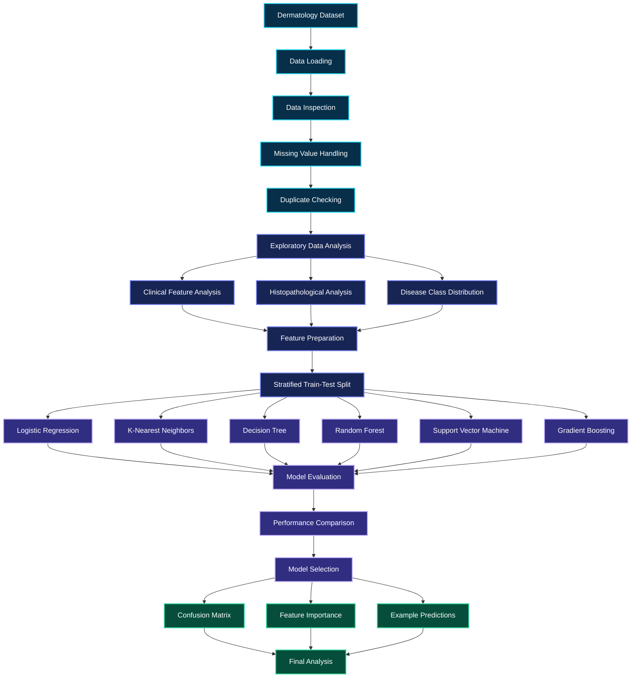
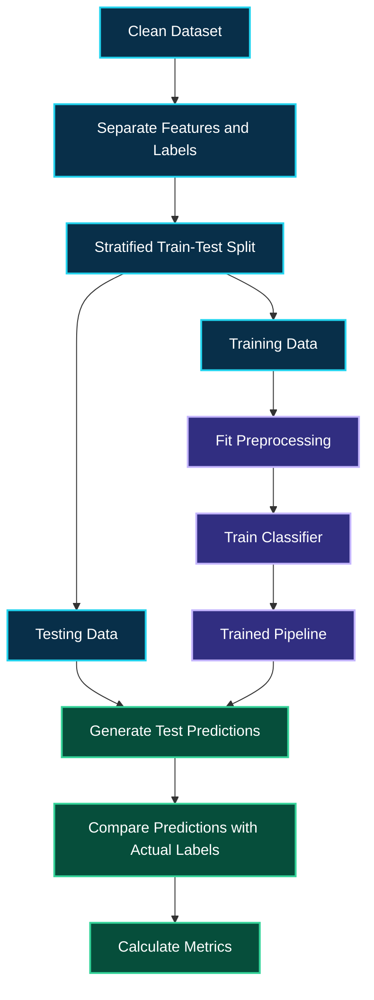
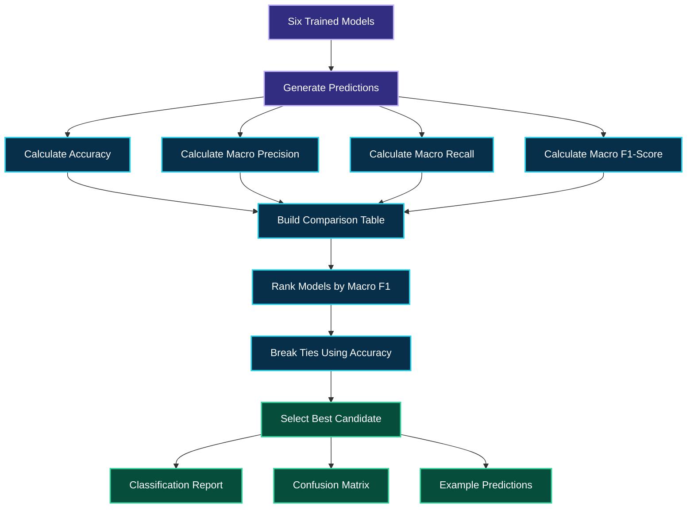

<div align="center">


<br/>


<br/><br/>


<br/><br/>


<br/><br/>

**34 FEATURES · 6 DISEASE CLASSES · 6 MACHINE LEARNING ALGORITHMS**

<br/>

<a href="#01-project-overview">OVERVIEW</a>   ◈   <a href="#02-system-architecture">ARCHITECTURE</a>   ◈   <a href="#06-machine-learning-laboratory">ML LAB</a>   ◈   <a href="#10-performance-analysis">PERFORMANCE</a>   ◈   <a href="#16-future-development">ROADMAP</a>

</div>

---

# 01. Project Overview

## Intelligent Skin Disorder Classification

Skin disorders may share similar clinical characteristics, making classification a challenging problem.

This project explores how machine learning algorithms can analyze structured dermatology data and classify observations into six disease categories.

The project follows a complete data science workflow, including data loading, data cleaning, exploratory data analysis, feature preparation, model training, performance evaluation, and model interpretation.

The objective is to compare different machine learning algorithms and understand their strengths and weaknesses on a multiclass classification problem.

### Project Objectives

**Medical Data Analysis**

Explore the structure, quality, and distribution of dermatology records.

**Feature Investigation**

Study clinical and histopathological attributes to understand patterns in the dataset.

**Machine Learning**

Train and compare six classification algorithms.

**Performance Evaluation**

Measure accuracy, precision, recall, and F1-score.

**Model Interpretation**

Analyze classification reports, confusion matrices, and feature importance.

**Responsible AI**

Understand why model predictions require careful interpretation, especially in healthcare applications.

## Project Highlights

| Component            | Description                      |
| -------------------- | -------------------------------- |
| Project ID           | PRCP-1027                        |
| Project Name         | Skin Disorder Prediction         |
| Domain               | Healthcare and Data Science      |
| Problem Type         | Multiclass Classification        |
| Dataset Records      | 366, as described in the project |
| Input Features       | 34                               |
| Target Classes       | 6                                |
| Algorithms           | 6                                |
| Development Tool     | Jupyter Notebook                 |
| Programming Language | Python                           |

The actual number of records remaining after cleaning should be confirmed from the executed notebook.

---

# 02. System Architecture

## From Raw Data to Machine Learning Intelligence

The project transforms raw dermatology records into evaluated classification models through a structured workflow.



### Workflow Stages

**Stage 1 — Data Collection**

Load the dermatology dataset into a Pandas DataFrame.

**Stage 2 — Data Cleaning**

Identify missing values, handle missing age entries, and check duplicate records.

**Stage 3 — Exploratory Analysis**

Examine the target distribution and investigate clinical and histopathological features.

**Stage 4 — Feature Preparation**

Separate the input features from the target labels.

**Stage 5 — Model Training**

Train six machine learning classifiers using the prepared data.

**Stage 6 — Model Evaluation**

Calculate multiple classification metrics.

**Stage 7 — Model Interpretation**

Investigate model errors, class-wise performance, and feature importance.

**Stage 8 — Final Analysis**

Summarize the comparative results and limitations.

---

# 03. Dataset Intelligence

## Understanding the Dermatology Dataset

The project description identifies a dataset containing 366 records and 34 input attributes.

The target column is named `class`, which identifies the disease category associated with each record.

The input features contain clinical and histopathological information.

### Dataset Summary

| Attribute                  | Description                              |
| -------------------------- | ---------------------------------------- |
| Records                    | 366 in the project description           |
| Input Features             | 34                                       |
| Target Column              | `class`                                  |
| Classification Classes     | 6                                        |
| Clinical Features          | 11, according to the project description |
| Histopathological Features | 22, according to the project description |
| Age                        | Numerical feature                        |
| Family History             | Binary feature                           |
| Learning Type              | Supervised Learning                      |

### Six Disease Classes

The notebook uses the following disease-class mapping.

| Class ID | Disease                  |
| -------: | ------------------------ |
|        1 | Psoriasis                |
|        2 | Seboreic dermatitis      |
|        3 | Lichen planus            |
|        4 | Pityriasis rosea         |
|        5 | Cronic dermatitis        |
|        6 | Pityriasis rubra pilaris |

The names above follow the terminology in the project description. They can be updated if the notebook uses different spellings.

### Clinical Features

Clinical features represent patient characteristics and clinical observations recorded in the dataset.

The project investigates average clinical feature values across disease classes to explore patterns in the observations.

### Histopathological Features

Histopathological features provide additional diagnostic information represented in the dataset.

Analyzing these variables helps explore how the recorded disease categories differ in their feature values.

These patterns are exploratory and do not establish medical causation.

---

# 04. Data Cleaning and Preprocessing

## Preparing Reliable Input Data

Data quality is an important part of machine learning.

The project performs preprocessing before fitting the classification models.

### Missing Value Handling

Some age values are represented by `?`.

The notebook converts these markers into missing values and uses median imputation to fill missing ages.

Median imputation helps retain records that would otherwise contain an unusable age value.

### Duplicate Checking

Duplicate records are checked during preprocessing.

If duplicate rows are present, they are removed before the subsequent analysis.

### Target Separation

The input features and target column are separated.

Conceptually, this operation is:

```python
X = df_clean.drop("class", axis=1)
y = df_clean["class"]
```

`X` contains the model input features.

`y` contains the disease-class labels.

### Feature Scaling

Some algorithms depend on distances or feature magnitudes.

StandardScaler standardizes numerical features using statistics learned from the training data.

The notebook includes scaling in the pipelines for algorithms that benefit from it.

### Pipeline-Based Preprocessing

A Scikit-learn Pipeline connects preprocessing and classification into one workflow.

This improves consistency between training and prediction and helps reduce data leakage caused by fitting preprocessing steps on the complete dataset.

---

# 05. Exploratory Data Analysis

## Discovering Patterns Before Training

Exploratory Data Analysis helps reveal the characteristics of the dataset before model development.

The project investigates several aspects of the medical data.

### Disease Class Distribution

The class distribution reveals how many observations belong to each disease category.

Unequal class frequencies can affect classification performance.

Macro-averaged metrics are useful because they give each class equal weight in the final average.

### Age Analysis

Age analysis explores the distribution of patient ages and differences between the recorded disease categories.

These patterns describe the dataset and should not be interpreted as population-wide medical conclusions.

### Clinical Feature Analysis

Clinical features are examined to understand their distributions and average values across the disease classes.

### Histopathological Feature Analysis

Histopathological features are analyzed to explore differences between the six target categories.

### Statistical Analysis

Descriptive statistics help identify feature ranges, unusual values, and differences in the numerical attributes.

The notebook generates the actual charts and summaries when executed.

---

# 06. Machine Learning Laboratory

## Six Algorithms. One Classification Problem.

The project compares six machine learning algorithms.

Each algorithm uses the input features to predict one of the six disease classes.

### 01. Logistic Regression

Logistic Regression provides a baseline classification model.

It estimates class probabilities using a linear decision structure.

Its performance provides a useful reference for comparison with more flexible models.

### 02. K-Nearest Neighbors

K-Nearest Neighbors classifies observations using nearby training records.

The notebook configures five neighbors.

Because KNN uses distances between observations, feature scaling can significantly affect its predictions.

### 03. Decision Tree

Decision Tree learns a sequence of feature-based rules.

It can capture nonlinear relationships and provides an interpretable structure.

However, individual decision trees may overfit their training data.

### 04. Random Forest

Random Forest combines multiple decision trees into an ensemble.

The notebook configures 300 trees.

The ensemble can capture complex feature relationships and is also used for feature-importance analysis.

### 05. Support Vector Machine

Support Vector Machine learns decision boundaries that separate classes.

Feature scaling is useful because input magnitudes can influence the resulting decision boundaries.

SVM provides a comparison against the linear and tree-based approaches.

### 06. Gradient Boosting

Gradient Boosting constructs an ensemble of decision trees sequentially.

Each new stage attempts to improve the existing model.

This approach can capture nonlinear relationships in structured data.

### Model Comparison

| Algorithm              | Learning Approach             | Purpose                        |
| ---------------------- | ----------------------------- | ------------------------------ |
| Logistic Regression    | Linear classification         | Baseline model                 |
| K-Nearest Neighbors    | Distance-based classification | Learn from nearby observations |
| Decision Tree          | Rule-based learning           | Capture nonlinear patterns     |
| Random Forest          | Tree ensemble                 | Combine multiple trees         |
| Support Vector Machine | Margin-based classification   | Learn separating boundaries    |
| Gradient Boosting      | Sequential tree ensemble      | Improve predictive performance |

The best algorithm must be determined from the actual evaluation results.

---

# 07. Model Training Architecture

## Building a Consistent Training Workflow

The notebook uses a stratified train-test split to divide the available observations into training and testing subsets.

The split is configured to use 80% of the records for training and 20% for testing.

Stratification helps preserve approximately the same class distribution across both subsets.



### Why Stratification Matters

A multiclass dataset may contain different numbers of observations in each class.

Stratification helps ensure that the training and testing subsets represent the class distribution more consistently.

It does not guarantee that the model will perform equally well on every disease class. That must be evaluated separately.

---

# 08. Evaluation Metrics

## Measuring Classification Performance

The notebook evaluates each model using four principal metrics.

### Accuracy

Accuracy measures the proportion of test observations correctly classified.

It provides a general overview of model performance.

### Macro Precision

Macro precision calculates precision for each class and averages the results equally.

It helps examine how reliable the model's positive predictions are across the six classes.

### Macro Recall

Macro recall calculates recall separately for each class and averages the results equally.

It helps evaluate whether the model identifies observations belonging to the different disease classes.

### Macro F1-Score

Macro F1-score calculates the F1-score for each class and averages the scores equally.

It is the primary criterion used by the notebook to select the model.

### Metrics Table

| Metric          | Purpose                         | Preferred Result |
| --------------- | ------------------------------- | ---------------- |
| Accuracy        | Overall correctness             | Higher           |
| Macro Precision | Average class-wise precision    | Higher           |
| Macro Recall    | Average class-wise recall       | Higher           |
| Macro F1-Score  | Balanced class-wise performance | Higher           |

No performance numbers are included here because they should come from the actual notebook execution.

---

# 09. Model Selection Engine

## Identifying the Best-Performing Candidate

The notebook ranks the trained models by macro F1-score.

If models have the same macro F1-score, accuracy is used as the secondary ranking criterion.

The selected candidate is then used for further analysis.



### Important Evaluation Note

The notebook uses the held-out test-set metrics for model selection.

Because the same test set is used to select the best candidate, its reported performance should not be treated as a completely independent estimate of the final selected model's generalization.

A separate validation set or nested cross-validation would provide a stronger evaluation methodology.

---

# 10. Performance Analysis

## Understanding the Results

The notebook includes several evaluation and interpretation steps.

### Model Comparison

Compare the macro F1-scores of all six algorithms to understand their relative performance.

### Accuracy Versus Macro F1

Comparing accuracy with macro F1-score helps identify situations where overall accuracy does not reflect performance across all classes.

### Classification Report

The classification report contains precision, recall, F1-score, and support for each disease class.

Support represents the number of actual test observations belonging to that class.

### Confusion Matrix

The confusion matrix shows the relationship between actual and predicted classes.

Correct predictions appear on the main diagonal.

Off-diagonal entries represent errors.

This helps identify which disease classes the model confuses.

### Feature Importance

The notebook uses a Random Forest to investigate feature importance.

The results can help identify which attributes the fitted model relies on most strongly.

Feature importance does not prove that a feature causes a disease, and the results can be affected by correlations between features.

### Results Dashboard

| Model                  | Accuracy     | Macro Precision | Macro Recall | Macro F1     |
| ---------------------- | ------------ | --------------- | ------------ | ------------ |
| Logistic Regression    | Run notebook | Run notebook    | Run notebook | Run notebook |
| K-Nearest Neighbors    | Run notebook | Run notebook    | Run notebook | Run notebook |
| Decision Tree          | Run notebook | Run notebook    | Run notebook | Run notebook |
| Random Forest          | Run notebook | Run notebook    | Run notebook | Run notebook |
| Support Vector Machine | Run notebook | Run notebook    | Run notebook | Run notebook |
| Gradient Boosting      | Run notebook | Run notebook    | Run notebook | Run notebook |

Replace these placeholders with the values generated by the notebook.

---

# 11. Prediction Workflow

## From Input Features to Predicted Class

The selected model processes the input feature values and predicts one of the six class IDs.

The notebook maps class IDs to their corresponding disease names and compares predictions with the actual test labels.


### Example Prediction Fields

| Field               | Meaning                |
| ------------------- | ---------------------- |
| `Actual_Class`      | Actual class ID        |
| `Actual_Disease`    | Actual disease name    |
| `Predicted_Class`   | Predicted class ID     |
| `Predicted_Disease` | Predicted disease name |

The notebook's example predictions demonstrate classification on held-out test observations. They do not establish diagnostic reliability for new patients.

---

# 12. Responsible AI in Healthcare

## Supporting Analysis Without Replacing Medical Expertise

Healthcare machine learning requires careful interpretation.

A model prediction is not equivalent to a confirmed medical diagnosis.

### Responsible Use Principles

**Validate the data**

Ensure input features are complete and represented correctly.

**Review predictions carefully**

Consider predictions alongside appropriate clinical evidence.

**Investigate errors**

Review false positives, false negatives, and confusion between disease classes.

**Evaluate generalization**

Test the model on independent data before considering real-world use.

**Protect patient information**

Use appropriate privacy and security controls for medical data.

**Maintain human oversight**

Clinical decisions must remain under appropriate medical supervision.

### Clinical Limitation

This project is an educational machine learning exercise.

The model has not been established as a clinically validated diagnostic system and must not replace professional medical assessment.

---

# 13. Technical Challenges and Solutions

## Engineering Decisions Behind the Workflow

| Challenge                   | Approach                                                  |
| --------------------------- | --------------------------------------------------------- |
| Missing age markers         | Convert `?` to missing values and impute                  |
| Duplicate observations      | Check and remove duplicate rows when present              |
| Different feature scales    | Use StandardScaler where appropriate                      |
| Multiple disease classes    | Train multiclass classification models                    |
| Unequal class frequencies   | Use stratified splitting and macro metrics                |
| Consistent preprocessing    | Use Scikit-learn pipelines                                |
| Comparing different models  | Apply a common evaluation framework                       |
| Understanding errors        | Analyze confusion matrices                                |
| Interpreting model behavior | Examine feature importance                                |
| Limited dataset size        | Document limitations and recommend independent validation |

---

# 14. Repository Structure

## Existing Project Files

The following is a simple example of how your repository may look.

```text
PRCP-1027-Skin-Disorder-Prediction/
|
|-- PRCP-1027-Skin_Disorder_Complete_Project.ipynb
|
|-- dataset_35_dermatology (1).csv
|
|-- README.md
```

**Important:** This is an example, not a verified list of your uploaded files. Keep the exact filenames that are already present in your GitHub repository.

You do not need to create an `assets` folder or upload separate chart images for the animated text and Mermaid diagrams in this README.

The notebook can generate its charts when you execute its cells.

---

# 15. Installation and Execution

## Run the Notebook Locally

### Step 1 — Clone Your Repository

Replace the placeholder with your actual GitHub repository URL.

```bash
git clone YOUR_GITHUB_REPOSITORY_URL
```

### Step 2 — Open the Project Folder

```bash
cd YOUR_PROJECT_FOLDER
```

### Step 3 — Install the Required Libraries

```bash
python -m pip install numpy pandas matplotlib scikit-learn jupyter
```

### Step 4 — Check the Dataset

Ensure that the CSV file is available in the location expected by the notebook.

If the notebook expects a particular filename, use that exact filename.

### Step 5 — Launch Jupyter Notebook

```bash
jupyter notebook
```

### Step 6 — Execute the Notebook

Open the project notebook and execute the cells in order.

### Step 7 — Review the Outputs

Review the generated data analysis, model comparison table, evaluation metrics, confusion matrix, feature importance, and example predictions.

---

# 16. Future Development

## Expanding the Project

### Phase 01 — Stronger Validation

Use cross-validation or a separate validation set to improve model selection.

### Phase 02 — Independent Testing

Evaluate the selected model on independent data to investigate generalization.

### Phase 03 — Model Explainability

Investigate explainability methods to understand the relationship between input features and predictions.

### Phase 04 — Prediction Confidence

Explore probability calibration and uncertainty reporting.

### Phase 05 — Interactive Application

Build an interactive interface using Streamlit to demonstrate the classification workflow.

### Phase 06 — Automated Testing

Add tests for input validation, preprocessing, prediction outputs, and model loading.

### Phase 07 — Responsible Deployment

Investigate privacy, fairness, external validation, and clinical requirements before considering practical healthcare applications.

---

# 17. Technical Skills Demonstrated

## Data Science Competencies

| Category             | Skills                                     |
| -------------------- | ------------------------------------------ |
| Programming          | Python                                     |
| Data Manipulation    | Pandas, NumPy                              |
| Data Cleaning        | Missing-value handling, duplicate checks   |
| Exploratory Analysis | Statistical summaries and feature analysis |
| Visualization        | Matplotlib                                 |
| Machine Learning     | Six classification algorithms              |
| Preprocessing        | SimpleImputer, StandardScaler              |
| Pipeline Engineering | Scikit-learn Pipeline                      |
| Model Evaluation     | Accuracy, precision, recall, F1-score      |
| Error Analysis       | Confusion matrix                           |
| Interpretation       | Feature importance                         |
| Prediction Analysis  | Actual versus predicted labels             |
| Documentation        | Markdown and Mermaid                       |
| Development          | Jupyter Notebook                           |

---

# 18. Project Conclusion

## Transforming Dermatology Data Into Predictive Insights

The Skin Disorder Prediction project demonstrates an end-to-end machine learning workflow for a six-class dermatology classification problem.

The workflow begins with data inspection and preprocessing, continues through exploratory analysis and model training, and concludes with comparative evaluation and model interpretation.

Six machine learning algorithms are evaluated using accuracy, macro precision, macro recall, and macro F1-score.

The selected candidate is then investigated through class-wise evaluation, confusion-matrix analysis, feature importance, and example predictions.

The project demonstrates the importance of consistent preprocessing, fair model comparison, and evaluation across all target classes.

It also highlights an essential principle of healthcare AI: predictive performance alone is not sufficient to establish clinical reliability.

Independent validation and appropriate clinical oversight are necessary before considering real-world medical applications.

---

# 19. About the Developer

<div align="center">


<br/><br/>

<a href="https://github.com/govardhan-goud123">

</a>

<br/><br/>

Interested in Data Science, Artificial Intelligence, Machine Learning, Natural Language Processing, and practical AI applications.

</div>

---

<div align="center">


**EXPLORE THE DATA. TRAIN THE MODEL. UNDERSTAND THE RESULTS.**

</div>
